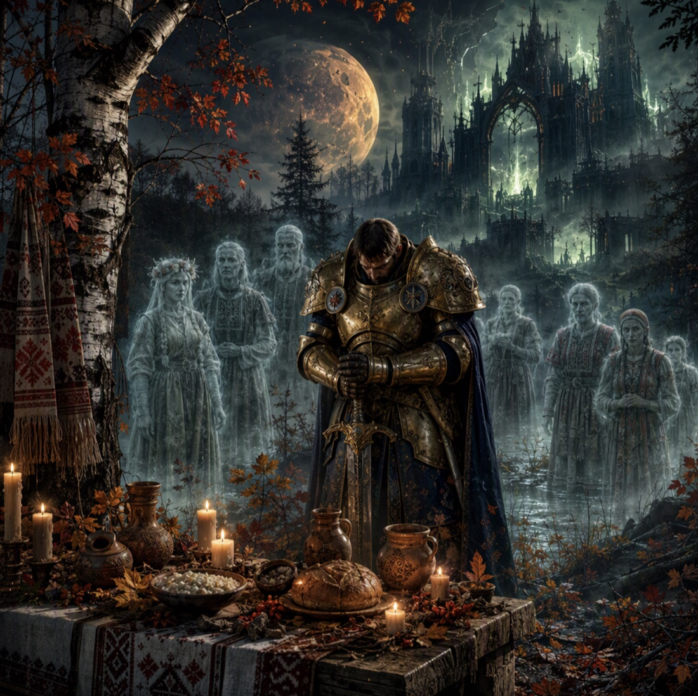

31 октября полмира празднует Хэллоуин: тыквы, костюмы, конфеты, страшилки...

У нас же на следующий день отмечаются Дзяды - день памяти предков. За столы садятся всей семьёй и зовут тех, кто когда-то за ним сидел, а теперь приглядывает за домом из другого мира.

Мы тоже призовём предков за столы — только за игровые. Приглашаем на одиночный турнир по Age of Sigmar «This is ДЗЯДЫ!!!»

Приходите играть и помнить.

## Время и место

📅 Когда: 1 ноября 10.00
📍 Где: Клуб "Логово Дракона", г.Минск, ул. Кальварийская, 21/8
💰 Стоимость участия: 40 BYN

## Регламент

- Для участия необходимо зарегистрироваться в чат-боте [@RBWargameBot](https://t.me/RBWargameBot). 
- Регистрация заканчивается в 23:59 24.10.2026.
- Заморозка правил состоится в это же время.
- В случае нечетного количества игроков будут осуществлены поиски прокси-бота.  

## Судьи

- Алексей
- Илья
- Роман

## Расписание турнира

| Начало | Конец | Этап |
| ------ | ----- | --------------------------- |
| 10:00 | 10:30 | Паринги и регистрация |
| 10:30 | 13:30 | 1 тур |
| 13:30 | 14:15 | Перерыв |
| 14:15 | 14:30 | Паринги |
| 14:30 | 17:30 | 2 тур |
| 17:30 | 17:45 | Перерыв |
| 17:45 | 18:00 | Паринги |
| 18:00 | 21:00 | 3 тур |
| 21:00 | 21:30 | Награждение |

## Миссии турнира

- Hidden Under Ash-Clouds
- Avalanche of Ash
- Caverns of Slaughter

## Начисление очков

За партию можно получить до 20 турнирных очков, которые делятся между игроками следующим образом:

- ничья означает счет 10-10;
- минорная победа по тактикам(при равенстве очков) означает счет 11-9;
- победа с отрывом не более 5 очков — счет 12-8;
- победа с отрывом в 6-10 очков — счет 13-7;
- победа с отрывом в 11-15 очков  — счет 14-6;
- победа с отрывом в 16-20 очков  — счет 15-5;
- победа с отрывом в 21-25 очков  — счет 16-4;
- победа с отрывом в 26-30 очков — счет 17-3;
- победа с отрывом в 31-35 очков — счет 18-2;
- победа с отрывом в 36-40 очков — счет 19-1;
- разгром с отрывом 41 и более очков — счет 20-0. 

В случае равенства побеждает тот кто выполнил больше тактик.

## Как вести себя с оппонентом?

Главное правило: будьте дружелюбны. Постарайтесь разрешать все споры ко взаимному удовольствию. Пожалуйста, не подсказывайте игрокам во время их игр (независимо от того, являетесь ли вы участником данной команды, другим участником турнира или просто зрителем). Это неспортивно и создает неравные условия для участников. Единственный повод вмешаться в игру — ситуация, когда вы видите явное нарушение правил. Например, если игрок делает больше атак, чем должен. Читерство, замедленная игра, злонамеренная нецензурная лексика и тому подобное недопустимы и приведут к снятию с турнира. Мы оставляем за собой право опубликовать имя читера и не допускать к другим турнирам.

## Контроль времени

Если хотя бы один из игроков хочет играть с контролем времени, то игра проходит с шахматными часами с лимитом времени 1 час и 30 минут для каждого игрока.

Предоставлением часов занимается заявившая сторона. Каждый игрок должен сам следить за собственным временем и переключать часы по окончании своих действий. В том числе можно переключать часы на действия оппонента, производимые в ваш ход, например, на использование командной способности Redeploy.

Игрок, потративший всё своё время, может только кидать спас броски, обязательную варду, убирать потери и получать очки за контроль точек. 

Если время игрока закончилось в момент выполнения атаки, он может завершить это действие. 

Если время игрока завершилось в течение его хода, и к этому моменту он уже выполнил условия заявленной тактики то она будет ему засчитана. Однако помните, что после истечения своего времени игрок не может выбирать боевые тактики и не может получать очки за них, даже если их выполнение не требует никаких действий. 

Время на игру начинается с броска на выбор стороны. Расстановка входит в личное время игрока. Если у вас есть сложный вопрос, который требует разъяснения судьи или опытного игрока, а никого нет рядом, то приостановите время для обоих игроков, чтобы связаться судьей.
